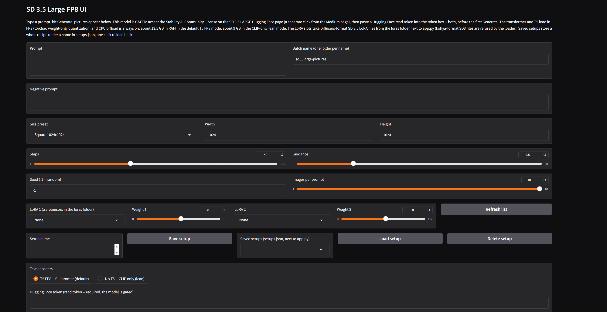
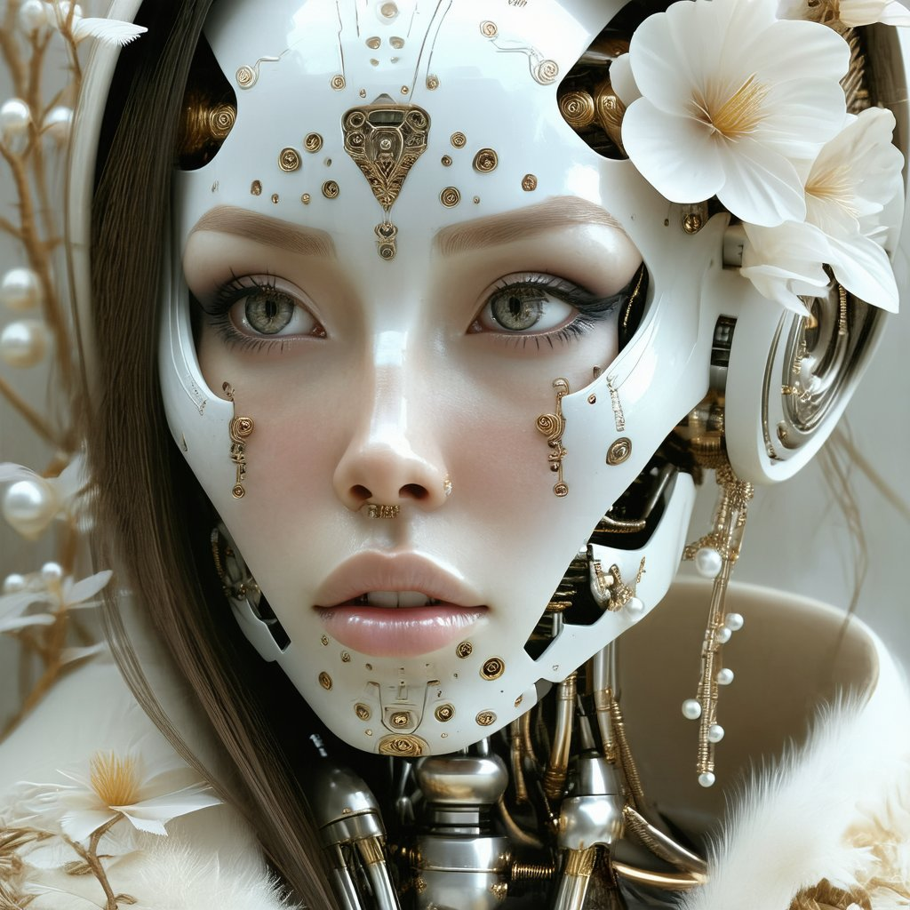

# SD 3.5 Large FP8 UI

*The app: one page, type a prompt, hit Generate. Defaults shown -- Square 1024x1024, 40 steps, guidance 4.5, T5 FP8 mode.*

## Before you start

- **Python: nothing to install.** Python 3.12 is included in this package, in the `python_embeded` folder, ComfyUI portable style. If you have **Python 3.10** (or any other Python) for other apps, it is left completely alone and is not needed here — Diffusers 0.42 dropped Python 3.10, which is why this app carries its own 3.12.
- **This model is GATED — two steps, both required, before the first Generate can succeed:**
  1. Go to the [SD 3.5 Large model page](https://huggingface.co/stabilityai/stable-diffusion-3.5-large), sign in, and **accept the Stability AI Community License** there. **This is a separate click from the SD 3.5 Medium page** — accepting the license on Medium does NOT carry over; each repo has its own acceptance, and skipping this one is the usual cause of a 403 refusal.
  2. Create a Hugging Face **read token** on the [Access Tokens page](https://huggingface.co/settings/tokens), and **paste it into the token box in the app**. The same read token the Medium app uses works here — same account for both steps.
  Without both, Hugging Face refuses the download (a 403) and the app's status line says exactly that, in plain language. No way around it — that is Stability's gate, not a bug in this app.
- A Windows PC with an NVIDIA graphics card (12 GB VRAM is the design target), about **35 GB free disk space**, and an internet connection.
- The first Generate downloads the model weights: **about 27.5 GB in total**. The files on the repo are BF16 — the FP8 in this app's name happens on your machine at load time (below). The CLIP-only lean mode skips the T5 files and downloads about 18 GB.
- **Status: PC proven.** This build was installed and proven on the author's PC (RTX 4070 12 GB, 16 GB RAM) on Oct 31, 2026: first picture at 1024x1024 / 40 steps in the default T5 FP8 mode in about 1 minute 38 seconds, then a 10-image batch and a multi-line prompt queue in the same session, no silent exit, no out-of-memory. An earlier build of this app failed its first Generate in both encoder modes on a naive FP8 dtype cast; this build replaces that load with torchao FP8 quantization (the failure and the fix are documented in How it works and Code verification). If you are updating an install of the earlier build: replace `app.py` and `requirements.txt`, run `install.bat` once (it adds torchao), then `run.bat` as usual.

**SD 3.5 Large, without Jupyter and without Colab.**

Stable Diffusion 3.5 Large is Stability AI's 8B-parameter MMDiT image model: the strongest prompt following in the SD 3.5 family (three text encoders — CLIP-L, CLIP-G, and T5-XXL), at a size that needs a plan to fit a 12 GB card. The plan here is the FP8 pattern: the transformer and the T5 encoder are cast to FP8 as they load (halving their memory), everything runs under CPU offload, and the whole thing is wrapped in the same plain app shape as the SD 3.5 Medium UI — run it, a page opens in your browser, type a prompt, pictures appear. Free forever.

## Example renders

All rendered with this app on an RTX 4070 12 GB, T5 FP8 mode, 1024x1024, 40 steps, guidance 4.5.

*Marble goddess -- the first picture this build ever rendered (frame 000001, seed 38829503). Prompt: "A marble goddess, cracked stone skin wrapped in gold and silver filigree, gold veins coming thru cracks, piercing blue eyes broken glass halo, divine light, cinematic close-up portrait, ultra detailed"*

*Marble goddess, same prompt, from the 10-image proof batch (frame 000005, seed 1322981363) -- heavier gold leaf in the cracks.*

*Neon double exposure (frame 000012, seed 1254106448) -- bioluminescent double-exposure portrait prompt (Butterfield / Goldsworthy / Vilardell style string), run as a 10-image queue line.*

*Neon double exposure, same prompt (frame 000019, seed 1864168042) -- glowing floral filigree at the temple.*

*Porcelain cyborg (frame 000028, seed 364014463) -- biomechanical porcelain-face cyborg prompt with silver-gold filigree and white blossoms, 10-image queue line.*

*Porcelain cyborg, same prompt (frame 000031, seed 724750310).*

## What it does

- Text-to-image generation on your own GPU -- no cloud, no Stability account (a free Hugging Face account is needed for the gate, above)
- Prompt + negative prompt (real classifier-free guidance — negatives genuinely steer), steps slider (default 40), guidance slider (default 4.5) — the SD 3.5 family's own values
- Text-encoder choice: **T5 FP8 — full prompt (the default)** or **No T5 — CLIP only (lean)** — see Requirements for the memory math
- CPU offload is **always on** — there is no off switch, because the full weight set fits no 12 GB card in any mode
- Two LoRA slots with weight sliders (0.0–1.5, default 0.8) — Diffusers-format SD 3.5 LoRA files (.safetensors) dropped in the `loras` folder; see **LoRAs** below for the honest format limits
- Saved setups — a whole recipe (prompt, negative, steps, guidance, size, seed, encoder mode, batch name, LoRA picks) stored under a name in `setups.json` and loaded back in one click; see **Saved setups** below
- Hugging Face token box (password field — the token is used for the download and never written to settings.txt, setups.json, or anywhere else)
- Size presets (Square 1024, Small square 768, Portrait 768x1024, Landscape 1024x768) plus custom width/height boxes, up to 2048
- Up to 10 pictures per prompt — rendered as separate single calls, one after another, never a batched call — each with its own seed, saved as 000001.png, 000002.png, and so on
- Seed shown in the status line (-1 = random; a fixed seed S gives S, S+1, S+2, ... across a multi-image run)
- A Random prompt button (word banks built in, no list file), and a session-only prompt history dropdown
- A Stop button to cancel a run, and Star batch to copy a batch into images_out/favorites/
- A prompt queue (one prompt per line -- when it has lines, Generate runs the queue instead of the single prompt box, all lines sharing the one batch folder, frames numbered continuously, one settings.txt block appended per finished line — stop mid-queue and every finished line's frames AND settings survive, so the resume point is exact)
- Dynamic prompts: {a|b|c} groups, one random pick per group, re-expanded for every single image (prompt and negative prompt). settings.txt records the expanded prompt actually used
- An Unload models button to free VRAM and RAM, and memory freed between every image in a run (long queues keep working)
- Every run adds its pictures to the batch folder and appends a block to `settings.txt` next to them (date, time, frame range, model, encoder mode, dtypes, offload, size, steps, guidance, LoRA state, prompt, negative prompt, expanded prompts, seeds)

No animation, no upscaling, no editing, no ControlNet, no inpainting, no img2img -- v1 is text-to-image only, kept simple on purpose.

## LoRAs

Two slots, each with a weight slider (0.0 to 1.5, default 0.8 — 0.8 to 1.0 is the usual working range; lower is subtler, higher is stronger and can start to fight the prompt).

1. Drop `.safetensors` LoRA files into the `loras` folder. It sits **next to app.py, inside the `sd35large-ui` subfolder** of the app folder (the folder that holds `run.bat` has an `sd35large-ui` folder inside it; `app.py` and `loras` are in there).
2. Pick a file in the **LoRA 1** / **LoRA 2** dropdowns — hit **Refresh list** after adding a file while the app is running — set the weights, and Generate. `None` in a slot means no LoRA in that slot. (Known family quirk: a file added mid-session occasionally does not appear even after Refresh list — restarting the app always picks it up.)
3. Each run's `settings.txt` block records what was applied, e.g. `loras: my-style.safetensors @ 0.8`. Switching the picks between runs unloads the old adapters first, so a LoRA never leaks from one run into the next.

**The honest format limits.** Only **Diffusers/PEFT-format SD 3.5 LoRAs** load. **Kohya-format SD3 LoRA files are refused**: the Diffusers 0.42 SD3 loader has no kohya key conversion (the same wall the Medium app hit), so a kohya file matches zero of the loader's modules — and in this app a zero-match load counts as a **failure**, surfaced as a plain status message, never as a silent render without the LoRA. SDXL and SD 1.5 LoRAs are built for different models and do not work here either. An SD 3.5 LoRA may carry transformer weights, CLIP text-encoder weights, or both; whichever parts a file has are the parts that get applied. The slots work the same in both encoder modes: a LoRA's text-encoder parts land on the two CLIP encoders, and T5 itself never takes a LoRA (Diffusers' SD3 loader has no T5 LoRA path).

## Saved setups

One compact row under the LoRA row: type a name in the **Setup name** box and click **Save setup**; later, pick the name in the **Saved setups** dropdown and click **Load setup** to restore the whole recipe into the controls in one click. **Delete setup** removes the picked one; saving over an existing name replaces it, and the status line says so.

A setup captures: prompt, negative prompt, steps, guidance, size (preset plus custom width/height), seed, text-encoder mode, batch name, and both LoRA picks with their weights. Setups persist in `setups.json` next to `app.py` (created on the first save, readable by hand) and survive restarts; a code-only app.py swap does not touch it. If a setup names a LoRA file that is no longer in `loras/`, that slot loads as None and the status line names the missing file. The Hugging Face token is deliberately **not** part of a setup and is never written to `setups.json`. (The pattern is the Medium app's, PC-proven there Oct 29, 2026; in this app it is stub-verified — see Code verification.)

## Requirements

- Windows, an NVIDIA GPU (12 GB VRAM is the design target), and a recent driver
- Python 3.12 is bundled in the `python_embeded` folder: no Python install, no PATH changes, no venv — your other Pythons are left completely alone, and this app lives entirely in this folder
- Disk space: about 35 GB free for the first download (27.5 GB of weights), plus room for pictures
- System RAM — this is the honest part. With CPU offload, the weights live in **system RAM** while one component at a time uses the GPU:
  - **T5 FP8 mode (the default): about 13.5 GB of weights resident** — the FP8 transformer is about 8.2 GB, the FP8 T5 about 4.8 GB, and the BF16 CLIP encoders + VAE about 1.8 GB, with working headroom on top.
  - **CLIP-only lean mode: about 9 GB resident.**
  - On a **16 GB RAM** machine, T5 FP8 mode fits on paper but leaves Windows and a browser almost no headroom — expect it to crawl through the pagefile, possibly hard, until a RAM upgrade lands. CLIP-only is the comfortable 16 GB mode. On 32 GB or more, T5 FP8 is the right default and stays the default.
- What you give up with CLIP only: the two CLIP encoders carry the prompt in 77-token windows and the pipeline feeds zeros where the T5 embeddings would go (a documented Diffusers SD3 pattern). Short and medium prompts work well; long, complex, multi-clause prompts follow noticeably less closely than with T5 — in T5 mode the full prompt (up to the app's 256-token cap) is heard by T5.

## Install

1. Do the two gate steps in "Before you start" (license acceptance on the **Large** page + read token). Install works without them, but the first Generate will not.
2. Extract the whole zip somewhere plain, like `C:\AI\sd35large` — the folder holding `install.bat` is the app folder.
3. Double-click `install.bat` and wait -- it sets up pip inside the bundled Python, then installs PyTorch with CUDA plus the packages into it. Run it again if anything interrupts it; it resumes where it stopped.
4. Double-click `run.bat`. A page opens in your browser. Paste your token, type a prompt, hit Generate.

install.bat does NOT need re-running for code-only updates: if only app.py changed, just replace the file (in the inner `sd35large-ui` folder) and run run.bat again.

## First test

1. Leave everything at the defaults — T5 FP8, offload always on, 1024x1024, 40 steps, guidance 4.5 — paste your token, and hit Generate.
2. The first run downloads the model (about 27.5 GB on this load), so it takes a while -- that is the one-time download, not a stuck render. Loads after that are minutes, renders are minutes each: this is an 8B model under offload, not a distilled sprinter.
3. If the status says Hugging Face refused the download (403), the Large-page license acceptance is the problem nine times out of ten — it is a **separate click from Medium's page**. After that, check the token is a READ token from the same account that accepted.
4. On a 16 GB RAM machine, if T5 FP8 crawls, switch the encoder radio to **No T5 — CLIP only (lean)** and Generate again — the next run is the ~9 GB load. (The T5 download also shrinks: lean mode never fetches the T5 files.)
5. The three proofs, in order, are what turn this build from "code verified" to "proven" on your machine: one single image; a small queue of a few lines; a batch of more than three images at 1024x1024 — all in one session, no silent exit, no out-of-memory. (On the author's PC all three passed on Oct 31, 2026 — see the status note at the top.)

## Where pictures go

`images_out/` next to `run.bat`, one subfolder per batch name, reused across runs -- repeat runs with the same batch name add pictures to the same folder, numbered continuously (`000001.png`, `000002.png`, ...), so nothing is ever overwritten. `settings.txt` in the folder grows by one block per finished queue line (date, time, frame range, prompt, negative prompt, expanded prompts, size, steps, guidance, max sequence length, encoder mode, dtypes, offload, LoRA state, seeds). The token is never recorded. Starred batches land in `images_out/favorites/`.

## How it works

Diffusers 0.42.0, StableDiffusion3Pipeline:

1. The transformer loads separately: `SD3Transformer2DModel.from_pretrained("stabilityai/stable-diffusion-3.5-large", subfolder="transformer", quantization_config=TorchAoConfig(Float8WeightOnlyConfig()), torch_dtype=torch.bfloat16, token=<token box>)` — the repo ships only BF16 transformer files, so FP8 is torchao weight-only quantization at load: each Linear's weight is stored as an FP8 tensor with per-row scales (about 8.2 GB resident instead of 16.3 GB) and dequantized inside the linear forward, while biases stay BF16. **A dtype cast is NOT the same thing and does not work**: this app's first build loaded with `torch_dtype=torch.float8_e4m3fn`, and its first PC Generate (Oct 31, 2026) died on frame 000001 in both encoder modes — `Input type (struct c10::BFloat16) and bias type (struct c10::Float8_e4m3fn) should be the same` in T5 mode, `Promotion for Float8 Types is not supported` in CLIP-only mode — because a naive cast leaves raw FP8 biases and parameters inside a BF16/Float graph. Both error texts are reproduced and pinned by the build's bench 6 regression; the torchao structure and a running BF16 forward are bench 7 (see Code verification).
2. In T5 FP8 mode, the T5 is quantized the same way, through transformers' own TorchAoConfig: `T5EncoderModel.from_pretrained(..., subfolder="text_encoder_3", quantization_config=TorchAoConfig(Float8WeightOnlyConfig()), torch_dtype=torch.bfloat16)` — FP8 weight storage, BF16 compute, about 4.8 GB instead of 9.5 GB. It is never cast with `.to(float8)` either (the same naive-boundary risk, one component over). The single-file `text_encoders/t5xxl_fp8_e4m3fn.safetensors` in the repo is a ComfyUI-format file and is NOT used — the loader takes the repo's own `text_encoder_3` component and quantizes it. In CLIP-only mode, `text_encoder_3=None` and `tokenizer_3=None` are passed to the pipeline instead — verified in the diffusers 0.42.0 wheel: its `encode_prompt` checks `text_encoder_3 is None` and returns zero embeddings of the right shape, and the CLIP encoders carry the prompt.
3. `StableDiffusion3Pipeline.from_pretrained(..., transformer=<the FP8 transformer>, text_encoder_3=<the FP8 T5 or None>, torch_dtype=torch.bfloat16, token=...)` — the CLIP encoders and VAE load in BF16; pre-loaded components keep their FP8 dtype.
4. `enable_model_cpu_offload()` is called **always** — components park in system RAM and move to the GPU one at a time.
5. The pipeline call is `pipe(prompt, negative_prompt, height, width, num_inference_steps=<steps slider>, guidance_scale=<guidance slider>, max_sequence_length=256, generator)` with one CPU generator per image (seeded from the seed box), one call per image. The CPU generator is deliberate: it works identically under offload.
6. `max_sequence_length=256` is the pipeline's own default (and bench-verified against the real class); 512 would double the joint-attention sequence tensor on every image for a benefit only very long T5 prompts would see.
7. LoRAs load through the pipeline's own adapter API: each picked file loads once per Generate click with `load_lora_weights(<loras folder>, weight_name=<file>, adapter_name="lora<i>")`, then one `set_adapters(names, adapter_weights=weights)` applies both slots' weights; changing the picks unloads first with `unload_lora_weights()`. The API is PEFT-backed — that is why `peft` is pinned in requirements.txt.

## Code verification (no GPU in the build environment)

- `app.py` compiles clean (`py_compile`), and the real Gradio page builds against the pinned gradio 5.50.0: exactly one radio (the two encoder modes, T5 FP8 default), no offload checkbox anywhere, the token box a password field, all nine buttons wired (bench 5: 14/14 checks).
- **Tokenizer bench (bench 1: 13/13)** — the real loads the first Generate depends on, run in a pristine venv built from this bundle's own requirements.txt: CLIPTokenizer for `tokenizer` and `tokenizer_2` (vocab 49,408 each), and the T5 tokenizer for `tokenizer_3` via AutoTokenizer and T5Tokenizer (vocab 32,100 each — the test directory mirrors the real repo's `tokenizer_3`, which ships a `tokenizer.json` alongside `spiece.model`). The sentencepiece + protobuf chain (the Chroma lesson) is exercised functionally: transformers' SentencePieceExtractor parses `spiece.model` through the protobuf runtime (32,000 base pieces). A guard test fails if sentencepiece, protobuf, or tiktoken is removed from requirements.txt (each removal tested), and a negative control with protobuf imports blocked kills the extractor construction exactly as the chain dies without protobuf. One honest limitation, probed and recorded in loader-check.txt: transformers 5.20.2's AutoTokenizer slow-to-fast *conversion* of a bare spiece-only directory raises an error even with every pin present — the real repo ships `tokenizer.json`, so the app never takes that path. Files came from the canonical ungated sources (openai/clip-vit-large-patch14, google/t5-v1_1-xxl) plus `tokenizer.json` from the publisher's own mirror of the Large repo: the gated repo itself refuses anonymous downloads (HTTP 401, verified at build time), so the repo's own copies are first exercised by the PC install.
- **Transformer audit (bench 2: 6/6)** — without downloading 16 GB: the repo's real `transformer/config.json` and safetensors index (1,227 tensors, 16,292,561,536 bytes) plus each shard's safetensors header fetched by HTTP range request, against an SD3Transformer2DModel instantiated from that config on the meta device: **0 missing keys, 0 unexpected keys, 0 shape mismatches**, all dtypes BF16, header parameter total **8,146,280,768** (× 2 bytes = the index total exactly, as all-BF16 requires). (Config/index/headers came from the publisher's ModelScope mirror — same 401 story as the tokenizers.)
- **FP8 failure regression (bench 6: 4/4)** — the first build's naive-cast load, exercised on a tiny transformer with BF16 inputs, reproduces the first PC failure's two error texts on CPU: `Input type (c10::BFloat16) and bias type (c10::Float8_e4m3fn) should be the same` (the PC's Windows torch prefixes the types with `struct`) and, for the FP8/Float promotion shape, `Promotion for Float8 Types is not supported, attempted to promote Float8_e4m3fn and Float` — character-for-character the lean mode's PC text. The original build's bench 3 had in fact recorded the first text on CPU and shipped anyway (its contract was cast + load; the forward was assumed to be a CUDA-only path). That assumption is the miss this bench exists to never repeat.
- **torchao fix bench (bench 7: 15/15)** — the shipped load calls on the same tiny models, in a pristine venv built from the shipped requirements (torchao 0.18.0 included): the transformer's 32/32 Linear weights are torchao quantized tensors whose stored data is float8_e4m3fn, all 33 biases are BF16 (none FP8), and the exact BF16 forward bench 6 watched die now **runs** on CPU with finite output — weight-only dequant makes the CPU forward a real test here, unlike the raw-FP8 matmul. The T5 through transformers' TorchAoConfig: 12/12 Linears quantized, FP8 storage, forward runs. A tiny end-to-end pipeline call with quantized transformer + T5 handed in (the app's shape) produces an image. Recipe evidence is pinned too: diffusers 0.42.0's `PipelineQuantizationConfig(quant_backend="torchao")` form is rejected by its own signature-match validation on this stack (the diffusers and transformers TorchAoConfig signatures differ in transformers 5.20.2), so the app uses the per-component TorchAoConfig route the pinned config's own docstring demonstrates; the `quant_mapping` form constructs cleanly as the documented alternative.
- **Real check_inputs bench (bench 4: 8/8)** — StableDiffusion3Pipeline assembled from tiny real components in both encoder shapes (with and without `text_encoder_3=None`), using the real tokenizers: the real `check_inputs` accepts the app's exact call patterns (prompt + negative, 1024x1024, max_sequence_length 256), rejects a size that breaks the real divisibility rule (`vae_scale_factor × patch_size` — 16 on the real model) and a prompt-plus-embeds call, both with the real error texts; tiny end-to-end calls through the real pipeline code produced images in both encoder shapes, and a tiny end-to-end call (32x32, 2 steps) produces an image in both shapes.
- **Stub suite (19/19)** — the app driven end-to-end with a fake pipeline that mirrors the real class's argument defaults and check_inputs rules: loader call shapes in both modes (subfolders, each component receiving its own library's TorchAoConfig wrapping Float8WeightOnlyConfig with a BF16 load dtype, token passing and its absence when the box is empty), plus a source guard that fails if the naive FP8 cast shapes (`torch_dtype=torch.float8_e4m3fn` on a load, any `.to(torch.float8_e4m3fn)`) ever reappear, offload always called and `.to()` never, cache/reload rules (token value is not part of the key), the 403 status message from both the transformer load and the pipeline load (it names the Large page and the separate acceptance), per-image calls for a batch (never one batched call), queue line-by-line settings blocks, a mid-queue Stop that keeps finished lines' blocks and resumes numbering exactly, LoRA loads in Diffusers format, the kohya zero-match refusal (no image generated, status names kohya), the non-LoRA checkpoint refusal with the loader's real error text, adapter switching with no leak, saved-setups save/load round-trip plus the missing-LoRA and corrupt-file edges, and a scan proving the token string appears in **no** settings.txt, status line, or setups.json.
- The requirements set is the SD 3.5 Medium app's PC-proven pin set plus protobuf and tiktoken (the Chroma lesson) and torchao 0.18.0 (the FP8 fix — diffusers 0.42.0's TorchAoConfig refuses torchao below 0.15.0); see the notes at the top of requirements.txt for why torch-dependent pins are verified from wheel metadata rather than a Linux-host dry run.
- What the build machine could not verify was later proven on the author's PC (RTX 4070 12 GB, 16 GB RAM, Oct 31, 2026): the real Windows install, the gated download, the FP8 forward on CUDA, the first picture (40 steps in about 1:38), a 10-image batch, and multi-line queues — all in working order. Still untested on this app specifically: a render with a real SD 3.5 LoRA loaded (the slots are stub-verified here and PC-proven in the Medium app).

## Models and permissions

The model belongs to Stability AI — see its [Hugging Face page](https://huggingface.co/stabilityai/stable-diffusion-3.5-large) for terms. SD 3.5 Large is under the **Stability AI Community License**: free for research, non-commercial, and commercial use for organizations under $1M in annual revenue; an enterprise license is required above that. Outputs are yours subject to that license's terms. **The model is NOT MIT or Apache, and this app does not change that.** Nothing is bundled here and nothing is sold. This UI (the Gradio app, the wrapper, the installer) is by Alan Carmack.

## License

MIT for this UI code -- free to use, share, and change. The model has its own license, above.
